# macOS 26 + 微信 4.x 本地聊天记录导出：完整实战教程

> 从零编译 wx-cli → 取得数据库密钥 → 解密查询 → 批量导出精简版 Markdown。
> 本文按**真实踩坑顺序**记录，每一步都附终端截图、原因分析和最终解法。

**适用环境（本文实测）**

| 项目 | 版本 |
|---|---|
| 系统 | macOS 26（Darwin 25），Apple Silicon，SIP 开启 |
| 微信 | 4.x 官方包（Hardened Runtime 签名） |
| 工具 | wx-cli 0.6.3（Rust），Python 3.9（系统自带） |
| 终端 | Cursor 内置终端 / Terminal.app |

**最终结果**：26 个加密数据库解开 25 个，1730 个会话、约 149 万条消息导出为精简 Markdown（97 MB）。

> ⚠️ 本工具只用于导出**你自己的**微信数据。密钥文件和导出的聊天记录都是高度隐私数据，切勿上传或分享。

---

## 目录

1. [原理速览](#1-原理速览)
2. [编译 wx-cli](#2-编译-wx-cli)（坑 1、坑 2）
3. [便携模式配置](#3-便携模式配置)
4. [首次初始化：读取微信内存](#4-首次初始化读取微信内存)（坑 3、坑 4）
5. [补齐冷分片密钥：时序是关键](#5-补齐冷分片密钥时序是关键)（坑 5、6、7）
6. [验证](#6-验证)
7. [精简导出](#7-精简导出)
8. [日常使用与维护](#8-日常使用与维护)
9. [回滚与安全](#9-回滚与安全)
10. [FAQ：过程中真实问过的问题](#10-faq过程中真实问过的问题)
11. [项目结构与下载](#11-项目结构与下载)

---

## 1. 原理速览

微信 4.x 在本地用 **SQLCipher 4** 加密所有数据库（AES-256-CBC + HMAC-SHA512，页大小 4096，reserve 80）。**每个 `.db` 有独立的 32 字节密钥**，只在微信进程打开数据库时出现在内存里。

wx-cli 取密钥分两阶段：

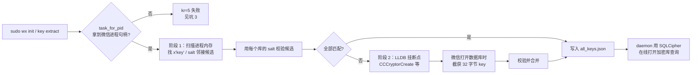

阶段 2 的断点挂在 CommonCrypto 的「创建解密器」函数上（`src/scanner/macos.rs`）：

```python
# LLDB 脚本（由 wx-cli 自动生成）
names = ["CCCryptorCreate", "CCCrypt", "CCCryptorCreateWithMode", "CCCryptorCreateFromData"]
for name in names:
    bp = target.BreakpointCreateByName(name)
    bp.SetScriptCallbackFunction(__name__ + ".on_cc")   # arm64: x3=key, x4=keyLength
    bp.SetAutoContinue(True)
```

**这句话是整篇教程的核心**：hook 只能抓到「挂上断点**之后**才被打开」的数据库。第 5 节所有的坑都源于此。

---

## 2. 编译 wx-cli

源码仓库原作者为私有，本文使用的是分叉版本（见 [第 11 节](#11-项目结构与下载)）。

### 2.1 把 Rust 装进项目目录

为了不污染系统，Rust 工具链装在项目内：

```bash
cd "/Users/you/Wechat Data"
export RUSTUP_HOME="$PWD/_build/rust-toolchain/rustup"
export CARGO_HOME="$PWD/_build/rust-toolchain/cargo"
curl --proto '=https' --tlsv1.2 -sSf https://sh.rustup.rs | sh -s -- -y --no-modify-path --profile minimal
export PATH="$CARGO_HOME/bin:$PATH"
rustc --version   # rustc 1.99.1
```

### 2.2 坑 1：链接失败 `tapi error: unknown architecture`

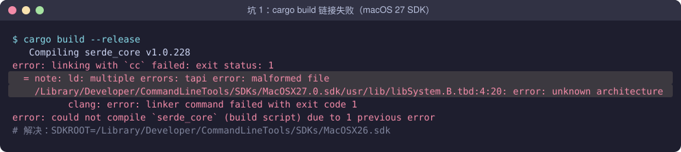

**原因**：系统的 Command Line Tools 默认 SDK 是 `MacOSX27.0.sdk`，其中 `.tbd` 文件里的架构名对当前 Rust 调用的链接器来说是「未知架构」。连一个 `hello world` 都链接不过：

```bash
$ rustc m.rs                                    # 默认 SDK → 失败
$ SDKROOT=.../SDKs/MacOSX26.sdk rustc m.rs      # 指定旧 SDK → 成功
```

**解决**：用 `SDKROOT` 指向一个较旧的 SDK（`ls /Library/Developer/CommandLineTools/SDKs/` 看看有哪些）：

```bash
export SDKROOT=/Library/Developer/CommandLineTools/SDKs/MacOSX26.sdk
```

### 2.3 坑 2：OpenSSL 构建失败——路径里有空格

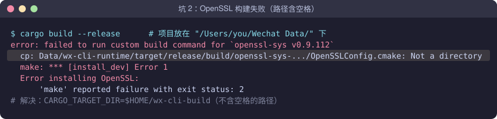

**原因**：`rusqlite` 开启了 `bundled-sqlcipher-vendored-openssl`，会现场编译 OpenSSL。OpenSSL 的 `make install` 脚本没有正确处理带空格的路径，`/Users/you/Wechat Data/...` 被拆成了 `/Users/you/Wechat` 和 `Data/...`。

**解决**：把编译输出目录放到**不含空格**的路径：

```bash
export CARGO_TARGET_DIR="$HOME/wx-cli-build"
```

### 2.4 编译成功

```bash
cd wx-cli
cargo build --release
cp "$CARGO_TARGET_DIR/release/wx" ../wx
```

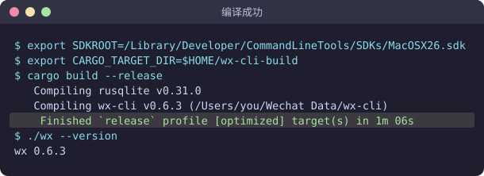

> 编译完成后可以把 `~/wx-cli-build` 挪回项目的 `_build/target/`，不影响已经产出的二进制。

---

## 3. 便携模式配置

wx-cli 默认把配置和密钥写到 `~/.wx-cli/`。我们希望**所有东西都留在项目文件夹里**。读源码发现它按这个顺序找 `config.json`（`src/config.rs`）：

```rust
fn find_existing_config_path(cwd_dir, exe_dir, home_dir) -> Option<PathBuf> {
    let candidates = [
        cwd_dir.map(config_path_in_dir),   // 1. 当前目录/config.json
        exe_dir.map(config_path_in_dir),   // 2. wx 二进制所在目录/config.json
        home_dir.map(home_config_path),    // 3. ~/.wx-cli/config.json
    ];
    candidates.into_iter().flatten().find(|path| path.exists())
}
```

所以只要在 `wx` 旁边放一个最小的 `config.json`，`init` 就会把 `db_dir` 和密钥写在这里：

```json
{
  "keys_file": "all_keys.json",
  "decrypted_dir": "decrypted"
}
```

> 注意：daemon 的 socket、日志、解密缓存仍固定在 `~/.wx-cli/`（代码里写死，无法改）。

---

## 4. 首次初始化：读取微信内存

保持微信**已登录**，在终端执行：

```bash
cd "/Users/you/Wechat Data"
sudo ./wx init
```

> 💡 输入 `sudo` 密码时屏幕**不显示任何字符**（连星号都没有），这是正常的，盲打 Mac 开机密码后回车即可。

### 4.1 坑 3：`task_for_pid 失败 (kr=5)`

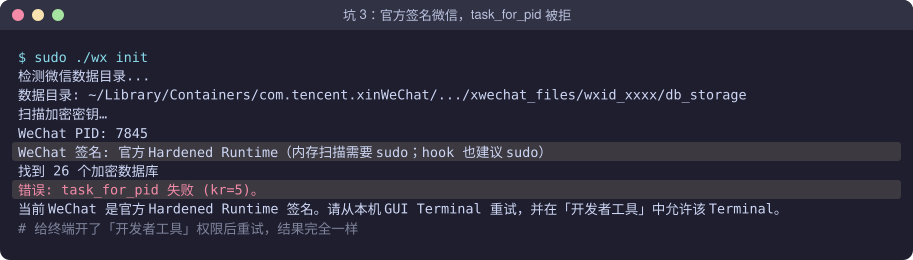

按提示去「系统设置 → 隐私与安全性 → 开发者工具」给终端打开权限，**重试结果完全一样**。

**原因分析**：

- 官方微信带 **Hardened Runtime**，且没有 `get-task-allow` 授权。
- 在新版 macOS 上，这类进程的 task port **对 root 也不开放**；「开发者工具」开关只对允许调试的 App 有效。项目文档里「官方签名 + 本机终端 + sudo = ✅」的实测只覆盖 macOS 10.15 / 11。
- LLDB 附加同样会被拦，而且内存扫描一失败，代码就直接 `bail!` 退出，根本走不到 hook 阶段。
- 另外：在 Cursor 内置终端里运行时，系统检查的「负责进程」是 **Cursor**，不是 Terminal.app。

**解决**：把微信重签为 ad-hoc 签名（去掉 Hardened Runtime）。

### 4.2 坑 4：重签名 `Operation not permitted`

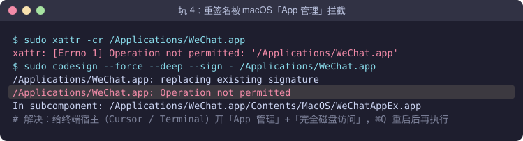

**原因**：macOS 的 **「App 管理」**（App Management）保护——没有授权的进程不能修改 `/Applications` 里的 App，`sudo` 也没用。

**解决**：

1. 「系统设置 → 隐私与安全性 → **App 管理**」打开你的终端宿主（Cursor 或 Terminal）。
2. 「隐私与安全性 → **完全磁盘访问**」同样打开。
3. **⌘Q 完全退出该程序再重开**（TCC 权限只在进程启动时检查）。
4. 重新执行重签名：

```bash
pgrep -x WeChat && echo "还在运行" || echo "已退出"     # 必须先退出微信
sudo xattr -cr /Applications/WeChat.app
sudo codesign --force --deep --sign - /Applications/WeChat.app
codesign -dv /Applications/WeChat.app 2>&1 | grep -E "Signature|flags"
```

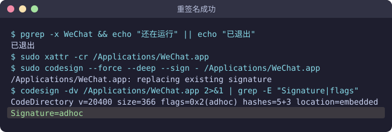

> **重签名的副作用**（做之前要清楚）：需要重新登录微信；截图/摄像头/麦克风等权限可能要重新授权；打开公众号会频繁弹「访问其他 App 的数据」；微信每次更新都会恢复官方签名，需再签一次；部分小程序可能报安全错误。

### 4.3 重新 init：只拿到 6/26

重开并登录微信（第一次因为微信没开，报了「找不到 WeChat 进程」），再跑 `sudo ./wx init`：

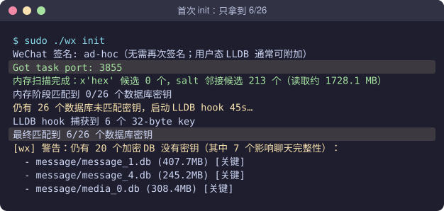

`Got task port` 说明重签名生效了。但内存扫描一个都没匹配上，hook 45 秒只抓到 6 个库（联系人、会话、最新的 `message_0.db` 等）。存旧聊天的 `message_1~5.db`、媒体库 `media_0.db` 全缺。

---

## 5. 补齐冷分片密钥：时序是关键

这是整个过程最曲折的部分，前后跑了 6 次。

### 5.1 在微信里多翻聊天：9/26 → 10/26

```bash
sudo ./wx key extract --hook-seconds 120
```

hook 期间翻旧聊天、看图、刷朋友圈，只多了几个小库。读第 1 节的 hook 源码后推断：**微信在登录时就打开了所有消息库并一直开着**，之后再怎么翻也不会重新「创建解密器」，hook 自然抓不到。

**思路**：让微信停在登录界面 → 挂 hook → 再登录，截获登录瞬间打开数据库的动作。

### 5.2 坑 5：以为重启了微信，其实没有

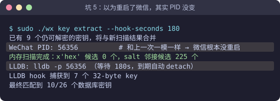

**判据**：`WeChat PID` 和上次一样 → 微信根本没重启（⌘Q 可能只关了窗口，或重开后自动登录了）。

**解决**：用命令彻底结束并确认：

```bash
killall WeChat; sleep 2; pgrep -x WeChat && echo "还在运行" || echo "已退出"
```

### 5.3 坑 6：挂上 hook 后忘了点登录

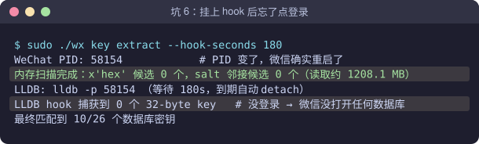

PID 变了，但 hook 期间没登录，微信没打开任何库，捕获 0 个。

### 5.4 坑 7：登录太早

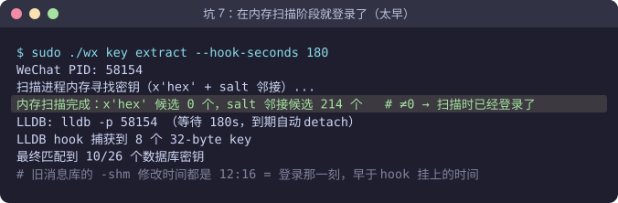

这次「感觉」顺序是对的，但还是 10/26。复盘发现两个铁证：

1. **内存扫描找到了 214 个 salt 候选**。微信停在登录界面时这个数是 **0**（坑 6 那次）。≠0 说明扫描时已经登录了——是在内存扫描的几十秒里点的登录，早于 `LLDB:` 那一行。
2. 微信数据目录里，所有旧消息库的 `-shm` 文件修改时间都是 **12:16**，正是登录那一刻，而 hook 是之后才挂上的：

```bash
ls -la ~/Library/Containers/com.tencent.xinWeChat/Data/Documents/xwechat_files/wxid_xxxx/db_storage/message/
# message_1.db-shm  ... Nov  8 12:16
# message_2.db-shm  ... Nov  8 12:16
```

### 5.5 正确时序 → 25/26 ✅

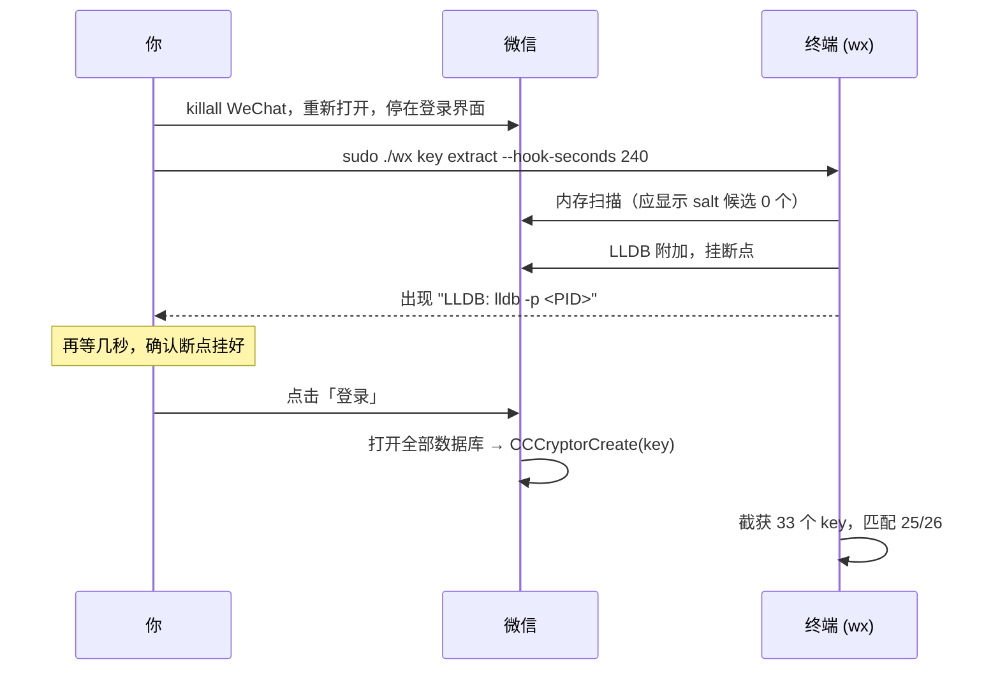

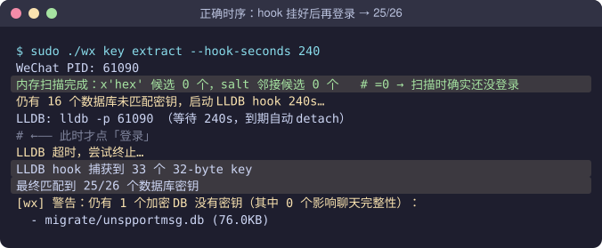

唯一缺的 `migrate/unspportmsg.db`（76 KB）是迁移遗留的旁路库，不影响聊天记录。

**自检清单**

| 现象 | 含义 | 处理 |
|---|---|---|
| `PID` 与上次相同 | 微信没重启 | `killall WeChat` 后确认已退出 |
| `salt 邻接候选` ≠ 0 | 扫描时已登录（太早） | 重来，等 `LLDB:` 出现再登录 |
| `salt 邻接候选` = 0 且捕获 0 | hook 期间没登录 | 重来，记得点登录 |
| 捕获很多 key 且匹配数上升 | ✅ 成功 | — |

---

## 6. 验证

后台 daemon 可能还缓存着旧密钥，先重启它：

```bash
./wx daemon stop
./wx doctor
```

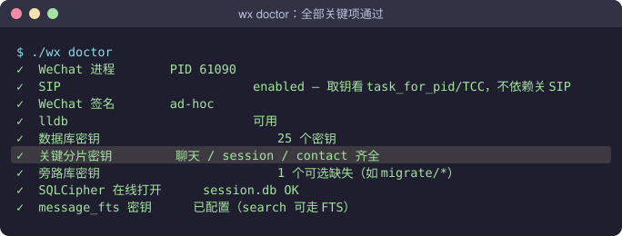

再挑一个老群验证旧消息能翻到：

```bash
./wx history "某个老群" -n 200000 --json | jq '.messages | length'
# 2544 条，2023-12-09 ~ 2024-09-02，meta.status = ok
```

> 补充：密钥不全时，`wx search` 仍可通过已解开的全文索引 `message_fts.db` 搜到旧消息的文字（本文实测可搜到 2022 年），这是一个可用的降级方案。

---

## 7. 精简导出

### 7.1 原生导出的问题

`wx export --format markdown` 会把系统消息、名片、引用的图片原样输出成大段 XML：

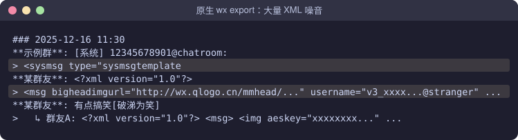

### 7.2 精简规则

写了脚本 `scripts/wx_export_md.py`（单个会话）和 `scripts/wx_export_all.py`（批量），基于 `wx export --format json` 二次加工：

| 类别 | 处理 |
|---|---|
| 图片、视频、语音、表情、位置、通话、拍一拍、系统消息 | **丢弃**（信息密度低） |
| 文字 | 保留，HTML 转义还原（`&lt;` → `<`） |
| 链接 / 文件 | 只留标题 / 文件名 |
| 群公告 | 提取 `<textannouncement>` 正文 |
| 名片 | 只留昵称 |
| 引用回复 | 压成一行：`回复内容（回复 某人: 原文前 60 字）`，引用图片写 `[图片]` |
| 排版 | 按日期 `## YYYY-MM-DD` 分组，每条 `- HH:MM **发言人**：内容` |

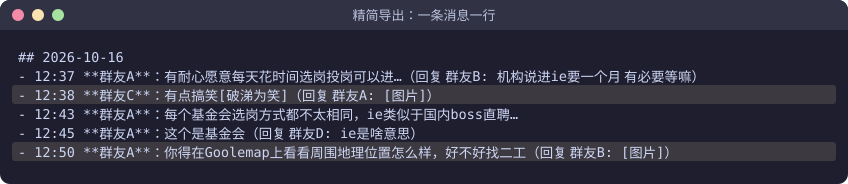

### 7.3 关键代码

按消息类型分流（`type_code` 来自 `wx export --format json`）：

```python
DROP_TYPE_CODES = {3, 34, 43, 47, 48, 50, 10000, 10002}  # 图片 语音 视频 表情 位置 通话 系统 撤回
DROP_APPMSG_TYPES = {8, 62}  # 表情包附件 拍一拍
```

引用的原文如果是媒体 XML，换成简短标记：

```python
def summarize_quoted(quoted: str) -> str:
    quoted = unescape_all(quoted)                      # 可能被转义了两层
    sender, sep, body = quoted.partition(": ")
    body = re.sub(r"^[\w\-@]+:\s*(?=<)", "", body)     # 去掉 "wxid_xxx:" 前缀
    if body.startswith("<"):
        if "<` 显示成 `&gt;&lt;` | 文本消息里的 HTML 转义 | 文本消息统一反转义 |
| 1730 个会话只有 1726 个文件 | macOS 文件名**不区分大小写**，`jia` / `Jia` 互相覆盖 | 用 `NFD + casefold` 判重，重名追加 `_wxid` |

### 7.5 批量导出

```bash
cd "/Users/you/Wechat Data"
python3 wx-cli/scripts/wx_export_all.py          # 已有文件跳过（断点续跑）
python3 wx-cli/scripts/wx_export_all.py --force  # 全部重导（带上新消息）
```

- 只导私聊和群聊，跳过公众号与折叠入口；无文字消息的会话跳过
- 输出 `exports/群聊/`、`exports/私聊/`，并生成按条数排序的 `exports/索引.md`
- 自检：`grep -rl '<?xml\|<msg\|aeskey' exports/` 必须无输出

本次结果：1938 个会话中导出 1730 个（群聊 233 / 私聊 1497），约 149 万条，用时约 80 秒。

### 7.6 写成 Cursor 规则

把「默认精简版、不导图片视频、导出后自检」写进 `.cursor/rules/wechat-export.mdc`（`alwaysApply: true`），以后让 AI 导出聊天时会自动遵守。

---

## 8. 日常使用与维护

日常查询**不需要 sudo**，微信也不必开着：

```bash
cd "/Users/you/Wechat Data"
./wx sessions                                   # 最近会话
./wx unread --filter private,group              # 真人未读
./wx history "联系人" -n 2000                   # 聊天记录
./wx search "关键词" --since 2023-01-01         # 全库搜索
./wx members "群名"                             # 群成员
```

| 情况 | 处理 |
|---|---|
| 查询提示 `unknown_shards` | 微信新建了消息库，按第 5.5 节时序再跑一次 `key extract` |
| 微信更新了 | 签名恢复为官方，先重签（第 4.2 节）再补密钥；已有密钥照常可用 |
| 群名含 emoji 匹配不到 | 先 `./wx sessions -n 500 --json` 找 `xxx@chatroom`，用 ID 查询 |

---

## 9. 回滚与安全

**恢复官方微信**：从官网重新下载安装即可覆盖回官方签名。若权限异常，重置 TCC：

```bash
for s in ScreenCapture Camera Microphone AppleEvents AddressBook \
         SystemPolicyDocumentsFolder SystemPolicyDownloadsFolder SystemPolicyDesktopFolder; do
  tccutil reset "$s" com.tencent.xinWeChat
done
```

**敏感文件**（`.gitignore` 已排除，切勿上传）：

| 文件 | 内容 |
|---|---|
| `all_keys.json` | 数据库解密密钥 |
| `config.json` | 含你的 wxid 和数据路径 |
| `exports/` | 全部聊天记录 |
| `~/.wx-cli/cache/` | 解密后的数据库缓存 |

---

## 10. FAQ：过程中真实问过的问题

**Q：输 sudo 密码为什么输不进去？**
A：输进去了，只是不显示。盲打 Mac 登录密码（不是微信密码）后回车；输错会提示 `Sorry, try again`。注意切到英文输入法。

**Q：我给了「开发者工具」权限，为什么还是 kr=5？**
A：新版 macOS 对 Hardened Runtime 进程的 task port 不开放，这个开关管不到；另外 Cursor 内置终端的授权对象是 Cursor。只能 ad-hoc 重签。

**Q：`key extract` 是要反复跑吗？**
A：不是。反复跑同样的操作没有收益，关键在**时序**：微信停在登录界面 → 挂 hook → 看到 `LLDB:` 再登录。一次做对就是 25/26。

**Q：是不是没办法了？**
A：前几次失败都能从输出里找到原因（PID 没变 / 没登录 / 登录太早）。看 `salt 邻接候选` 这个数：登录界面阶段必须是 0。

**Q：能导出图片和视频吗？**
A：能（`wx attachments` + `wx extract`），但信息密度低，本文的精简规则默认不导。

---

## 11. 项目结构与下载

**源码下载**：<https://github.com/0x-howard/wx-cli>（本教程作者维护的分叉，基于 Apache-2.0 协议的 wx-cli 0.6.3）

```bash
git clone https://github.com/0x-howard/wx-cli.git
```

本地工作目录整理后的结构：

```
Wechat Data/
├── wx                    # 编译好的二进制（便携模式）
├── config.json           # 便携配置（init 写入 db_dir）        ← 敏感
├── all_keys.json         # 数据库密钥                          ← 敏感
├── exports/              # 精简导出结果 + 索引.md               ← 敏感
├── .cursor/rules/        # wechat-export.mdc 导出规则
├── wx-cli/               # 源码（即本仓库）
│   ├── src/              # Rust 源码
│   ├── scripts/          # wx_export_md.py / wx_export_all.py
│   └── docs/tutorial/    # 本教程 + 配图生成脚本
├── _build/
│   ├── rust-toolchain/   # 项目内 Rust 工具链
│   ├── target/           # cargo 编译产物
│   └── logs/             # 三次编译日志（两次失败 + 一次成功）
└── _archive/             # 未采用的实验工具等
```

配图由 `docs/tutorial/make_images.py` 生成（已脱敏），修改后运行 `python3 docs/tutorial/make_images.py` 即可重新渲染。
