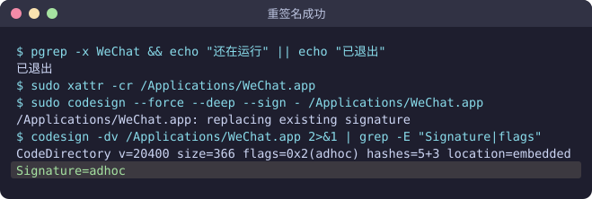
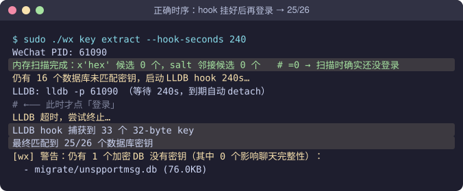
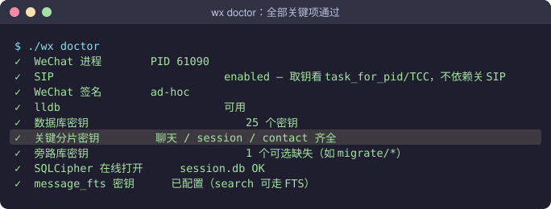
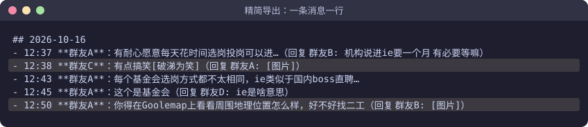

# 把微信聊天记录导出成文档：零基础图文教程

> 写给完全不懂电脑技术的人。做完以后，你会得到一个文件夹，里面是你所有群聊和私聊的文字记录，每个聊天一个文件。
> 全程基本是复制、粘贴、回车，大约 30～40 分钟（不含把手机聊天记录迁移到电脑的时间）。

---

## 一、作者的环境（本教程在这台电脑上完整跑通）

| 项目 | 作者的配置 |
|---|---|
| 电脑 | MacBook Air，**Apple 芯片**（arm64） |
| 系统 | **macOS 26.6.2**（Build 25G83），系统完整性保护 SIP 开启（不需要关） |
| 微信 | **微信 4.x 官网版**（Mac） |
| 工具 | wx-cli **0.6.3**（预编译好的 `wx`，见 [Releases](https://github.com/0x-howard/wx-cli/releases/tag/v0.6.3)） |
| Python | 系统自带 Python 3.9.6 |
| 终端 | Mac 自带「终端」/ Cursor 内置终端 |
| 结果 | 26 个加密数据库解开 25 个，1730 个聊天、约 149 万条消息导出成功 |

---

## 二、先判断你属于哪种情况

| 你的电脑 | 怎么做 |
|---|---|
| Mac + Apple 芯片（M1/M2/M3/M4…）+ 微信 4.x（和作者一样） | 看 **[第三部分：手动照做](#三手动照做和作者一样的-mac)**，或者交给 AI（第四部分） |
| Windows 电脑 | 看 **[第四部分：交给你的 AI 助手](#四交给你的-ai-助手windows--intel-mac--老系统--不想手动)** |
| Intel 芯片的 Mac | 同上，交给 AI（需要现场编译工具，AI 会帮你做） |
| 不确定 / 不想自己敲命令 | 同上，交给 AI |
| 微信是 3.x 老版本 | 先去微信官网把微信升级到 4.x |

不管走哪条路，都要先把手机上的聊天记录**迁移**到电脑微信（见第三部分「准备」一节）。电脑上没有的记录，导不出来。

怎么看自己的电脑：

- **Mac**：点左上角  →「关于本机」。「芯片」写着 Apple M… 就是 Apple 芯片，写着 Intel 就是 Intel 芯片。
- **Windows**：按 `Win + Pause`，或打开「设置 → 系统 → 关于」。
- **微信版本**：微信里「设置 → 关于微信」（Mac 在左上角「微信」菜单里）。

> 本工具只读取你自己电脑上的微信数据，不会上传到任何地方。请只用它导出你自己的聊天记录。

---

## 三、手动照做（和作者一样的 Mac）

### 准备：先把手机聊天记录迁移到电脑

电脑微信默认只保存在这台电脑上登录以后收到的消息，更早的聊天记录只在手机里。导出工具读的是电脑微信的数据库，所以要先把手机上的记录迁移过来。迁移得越全，最后导出的记录越全。

准备：

- 手机和电脑连同一个 Wi-Fi。
- 电脑微信已登录，而且和手机是同一个微信号。
- 手机电量充足，最好插着充电器；迁移过程中不要锁屏，也不要切到别的 App。

步骤：

1. 电脑微信：点左下角「≡」（更多）→「迁移与备份」→「迁移」→「从手机迁移到电脑」。
2. 手机微信：「我」→「设置」→「聊天」（有的版本在「通用」里）→「聊天记录迁移与备份」→「迁移」→「迁移到电脑微信」。
3. 选择要迁移的聊天：可以全部迁移，也可以只选部分聊天或某个时间段。
4. 用手机扫电脑上的二维码（或在手机上确认），开始迁移。

记录多的话要几十分钟到几个小时，期间两台设备都别关。电脑上显示「迁移完成」后再往下做。

> **要选「迁移」，不要选「备份」。**「备份到电脑」生成的是单独的加密备份包，导出工具读不到；只有「迁移到电脑」的记录会进入电脑微信的聊天数据库，才能被导出。
> 手机上已经删除的记录无法迁移。只迁移了部分聊天的话，导出结果也只有这部分，加上电脑上原本就有的记录。
> 不同版本的微信，菜单位置和名称可能略有不同，以实际界面为准。

### ⚠️ 开始前：了解这些影响

第 3 步要对微信做一次「重新签名」，会带来这些影响：

- 需要**重新登录一次微信**（聊天记录不会丢）
- 微信的截图、摄像头、麦克风权限可能要重新允许一次
- 打开公众号文章时，可能经常弹出「微信想访问其他 App 的数据」，点「允许」即可
- 以后**微信更新了**还想再导出，需要把第 3 步再做一遍

想恢复原样，去微信官网重新下载安装微信即可。

### 第 0 步：学会打开「终端」和粘贴命令

1. 按 `⌘ 空格`（command + 空格），输入 `终端`，回车，会打开一个窗口，这就是终端。
2. 本教程灰色框里的内容就是命令：复制 → 在终端里按 `⌘ V` 粘贴 → 按回车。
3. 每次只粘贴一个灰框，等它跑完（出现新的一行、光标在闪）再做下一个。

> **输入密码时屏幕上什么都不显示**（没有圆点，也没有星号），这是正常的。直接输完开机密码按回车；输错会提示 `Sorry, try again`，再输一次就行。输密码前请切到英文输入法。

### 第 1 步：安装苹果「命令行工具」

```bash
xcode-select --install
```

- 弹窗问是否安装 → 点「安装」，等它装完（5～15 分钟）。
- 显示 `already installed` → 已经装过，直接做下一步。

### 第 2 步：下载导出工具

把整个灰框一次性复制粘贴，回车：

```bash
mkdir -p ~/wechat-export && cd ~/wechat-export && \
curl -L --retry 5 -o wx https://github.com/0x-howard/wx-cli/releases/download/v0.6.3/wx-macos-arm64 && \
curl -L --retry 5 -o wx_export_md.py https://raw.githubusercontent.com/0x-howard/wx-cli/main/scripts/wx_export_md.py && \
curl -L --retry 5 -o wx_export_all.py https://raw.githubusercontent.com/0x-howard/wx-cli/main/scripts/wx_export_all.py && \
chmod +x wx && xattr -c wx && ./wx --version
```

**成功的样子**：最后一行显示 `wx 0.6.3`。

> 下载失败（比如出现 `SSL_ERROR_SYSCALL`）就再运行一两次；一直不行，看文末「常见问题」手动下载。

### 第 3 步：给终端开权限，并重新签名微信

**3.1 给「终端」开 3 个权限**

打开「系统设置 → 隐私与安全性」，在右边依次找到下面 3 项，把「终端」的开关打开。列表里没有「终端」就点 `+`，在「应用程序 → 实用工具」里选它。

| 设置项 | 用途 |
|---|---|
| 开发者工具 | 读取微信的密钥 |
| App 管理 | 对微信重新签名 |
| 完全磁盘访问权限 | 对微信重新签名 |

**3.2 彻底退出终端再打开（必须）**：点一下终端窗口，按 `⌘ Q`，再重新打开终端。权限要重启终端后才生效。

**3.3 退出微信**：

```bash
killall WeChat; sleep 2; pgrep -x WeChat && echo "微信还在运行，请手动退出" || echo "已退出"
```

看到 `已退出` 再继续。

**3.4 重新签名微信**（会要求输入开机密码）：

```bash
sudo xattr -cr /Applications/WeChat.app; sudo codesign --force --deep --sign - /Applications/WeChat.app && codesign -dv /Applications/WeChat.app 2>&1 | grep Signature
```

**成功的样子**：最后一行是 `Signature=adhoc`。



> 中间出现几行 `Operation not permitted` 不要紧，最后看到 `Signature=adhoc` 就是成功。
> 如果最后一行是 `Operation not permitted`：检查 3.1 里「App 管理」和「完全磁盘访问权限」是否打开，按 `⌘ Q` 重开终端后再做 3.4。

### 第 4 步：取出聊天记录的密钥（最关键，严格按顺序）

工具会在你登录微信的那一刻抓取密钥，所以顺序是：

> **先让工具准备好 → 再登录微信**

**4.1** 打开微信，**停在登录界面**（有「进入微信」按钮或二维码），先不要登录。

> 微信一打开就自动登录了？用 3.3 的命令退出，在登录界面取消自动登录后再来。

**4.2** 在终端启动工具（需要输入开机密码）：

```bash
cd ~/wechat-export && sudo ./wx key extract --hook-seconds 240
```

**4.3** 工具会先扫描几十秒，这期间不要动微信。等终端出现这一行：

```
LLDB: lldb -p 12345 （等待 240s，到期自动 detach）
```

**看到之后再等 5 秒**，然后切到微信，点「进入微信」登录。

**4.4** 登录后在微信里多点点：打开几个很久以前的聊天往上翻，点开几张旧图片，打开收藏和朋友圈。然后等终端自己结束（约 4 分钟），不要关窗口。

**4.5 看结果**：在终端里找这一行：

```
最终匹配到 25/26 个数据库密钥
```



- 两个数相等或只差 1～2 → 成功，去第 5 步。
- 差很多（如 `6/26`、`10/26`）→ 对照下表找原因，**从 4.1 重来**（已经拿到的密钥不会丢）：

| 终端里看到的 | 说明 | 怎么办 |
|---|---|---|
| `salt 邻接候选 200 个`（不是 0） | 登录太早了 | 退出微信（3.3），从 4.1 重来，等 `LLDB:` 出现后再登录 |
| `LLDB hook 捕获到 0 个` | 4 分钟内没有登录 | 从 4.1 重来，记得登录 |
| `找不到 WeChat 进程` | 微信没打开 | 打开微信停在登录界面，再做 4.2 |
| `task_for_pid 失败 (kr=5)` | 第 3 步没成功 | 重做第 3 步 |

### 第 5 步：检查

```bash
cd ~/wechat-export && ./wx daemon stop; ./wx doctor
```



「关键分片密钥  聊天 / session / contact 齐全」前面是 ✓ 就对了。最后一行 `daemon socket` 打 ✗ 不用管。

### 第 6 步：导出

**一次导出所有聊天（推荐）**：

```bash
cd ~/wechat-export && python3 wx_export_all.py
```

**只导出某一个群或某个人**：先用 `./wx sessions -n 50` 查名字，再运行：

```bash
cd ~/wechat-export && python3 wx_export_md.py "群名或备注名"
```

> 群名带表情符号、匹配不上时，用 `sessions` 结果里 `username:` 后面那串（如 `12345678@chatroom`）代替群名。

### 第 7 步：查看结果

```bash
open ~/wechat-export/exports
```

| 内容 | 说明 |
|---|---|
| `群聊/` | 每个群一个 `.md` 文件 |
| `私聊/` | 每个人一个 `.md` 文件 |
| `索引.md` | 所有聊天的目录，按消息数从多到少排列 |

`.md` 文件用「文本编辑」就能打开，用 Typora、Obsidian 或 VS Code 看更舒服。导出后只保留文字，图片、视频、表情和系统消息都会去掉，效果如下：



### 以后想更新

```bash
cd ~/wechat-export && python3 wx_export_all.py --force
```

一般不用再做第 3、4 步。提示 `unknown_shards` 时重做第 4 步；**微信更新版本后**要重做第 3、4 步。手机上有新的聊天记录要补进来，先按「准备」一节再迁移一次。

---

## 四、交给你的 AI 助手（Windows / Intel Mac / 老系统 / 不想手动）

如果你在用 Cursor、Claude Code、Codex、WorkBuddy 这类能在你电脑上执行命令的 AI 助手：

1. 把这份文档（`新手图文教程.md` 或 PDF）发给它，或者把下载链接给它：
   `https://github.com/0x-howard/wx-cli/blob/main/docs/tutorial/新手图文教程.md`
2. 复制下面这段话发给它：

```text
请阅读这份教程，尤其是「五、给 AI 助手的执行说明」。
先检测我电脑的系统、芯片架构和微信版本，告诉我属于哪条路线，
然后一步一步带我把微信聊天记录导出成精简版 Markdown。
需要输入密码、点登录、改系统设置的步骤，请告诉我怎么做，由我自己操作。
不要上传或展示我的密钥和聊天内容。
```

3. 照 AI 的提示做。遇到输入密码、点登录、改系统设置的步骤，AI 会让你自己操作。

开始之前，记得先按第三部分「准备」一节把手机聊天记录迁移到电脑。这一步只能你自己在手机和电脑上点。

---

## 常见问题

**Q：输密码时键盘按了没反应？** A：其实有输入，只是不显示。输完开机密码按回车即可。

**Q：提示 `command not found: python3`，或者弹窗让安装开发者工具？** A：第 1 步没装完，点「安装」，装完再继续。

**Q：出现 `zsh: permission denied: ./wx` 或「无法验证开发者」？** A：粘贴 `cd ~/wechat-export && chmod +x wx && xattr -c wx` 后再试；或者去「系统设置 → 隐私与安全性」最下面点「仍要打开」。

**Q：第 2 步下载一直失败？** A：用浏览器打开 <https://github.com/0x-howard/wx-cli/releases/tag/v0.6.3> 下载 `wx-macos-arm64`，改名为 `wx`，放进个人文件夹下的 `wechat-export` 文件夹（没有就新建）。两个 `.py` 文件在 <https://github.com/0x-howard/wx-cli/tree/main/scripts> 里点进去下载。然后运行 `cd ~/wechat-export && chmod +x wx && xattr -c wx && ./wx --version`。

**Q：第 4 步做了好几次，还是只拿到一半？** A：几乎都是登录时机不对。扫描时微信必须停在登录界面（终端显示 `salt 邻接候选 0 个`），并且要等 `LLDB:` 那行出现后再登录。

**Q：为什么导出的只有最近的聊天？** A：电脑微信里只有这些记录。先按第三部分「准备」一节把手机聊天记录迁移到电脑，再运行 `python3 wx_export_all.py --force` 重新导出。

**Q：怎么恢复原来的微信？** A：去微信官网重新下载安装，覆盖即可。

**Q：怎么彻底删除？** A：在终端运行 `rm -rf ~/.wx-cli ~/wechat-export`。

### 🔒 隐私提醒

- `~/.wx-cli/all_keys.json`（Windows 在 `%USERPROFILE%\.wx-cli\`）是打开你聊天记录的钥匙，`exports/` 里是你的全部聊天内容。**不要发给别人，不要上传网盘，也不要发给 AI。**

---

## 五、给 AI 助手的执行说明

> 本节写给 AI 助手（Cursor / Claude Code / Codex 等），人类读者可以跳过。

### 5.1 目标与约束

- **目标**：在用户本机用 wx-cli 取得微信 4.x 数据库密钥，再用 `wx_export_all.py` 把聊天导出为精简版 Markdown，放到 `<工作目录>/exports/`。
- **前置条件**：wx-cli 只能读到电脑微信本地数据库里的记录。开始前确认用户已在手机端用「聊天记录迁移与备份 → 迁移 → 迁移到电脑微信」把记录迁到这台电脑（是「迁移」，不是「备份」，备份包读不到）。步骤见第三部分「准备」一节，由用户自己操作。
- **必须由用户亲自操作**：输入 sudo / 管理员密码、点击微信登录、修改系统设置、确认对微信重签名。你给出命令和说明，等用户反馈或读取终端输出。
- **禁止**：读取、打印、上传 `all_keys.json` 的内容或聊天正文；未经用户同意修改 `/Applications/WeChat.app`；`cargo check` 或其他命令失败时假装成功。
- 工作目录用不含空格和中文的路径（macOS 用 `~/wechat-export`，Windows 用 `C:\wechat-export`）；vendored OpenSSL 在含空格的路径下构建会失败。
- 作者只在 macOS 26 + Apple 芯片上完整实测过；其他平台以 wx-cli 自身的提示（`wx doctor`、错误信息里推荐的命令）为准。

### 5.2 第一步：检测环境

macOS：

```bash
uname -m                      # arm64 = Apple 芯片；x86_64 = Intel
sw_vers                       # 系统版本
defaults read /Applications/WeChat.app/Contents/Info.plist CFBundleShortVersionString   # 微信版本，需 4.x
codesign -dv /Applications/WeChat.app 2>&1 | grep -E "flags|Signature"   # runtime=官方签名，adhoc=已重签
xcode-select -p && which lldb python3
```

Windows（PowerShell）：

```powershell
$env:PROCESSOR_ARCHITECTURE; [System.Environment]::OSVersion.Version
Get-Process Weixin -ErrorAction SilentlyContinue | Select-Object Path   # 微信 4.x 进程名为 Weixin.exe
(Get-Item (Get-Process Weixin).Path).VersionInfo.ProductVersion
python --version; rustc --version; git --version
```

### 5.3 选择路线

| 检测结果 | 路线 |
|---|---|
| macOS + arm64 + 微信 4.x | **路线 M1**：用预编译二进制，按第三部分执行 |
| macOS + x86_64 + 微信 4.x | **路线 M2**：源码编译，再按第三部分第 3～7 步执行 |
| Windows 10/11 x64 + 微信 4.x（Weixin.exe） | **路线 W**：源码编译，用管理员 PowerShell 取密钥 |
| 微信 3.x（Mac 进程名 WeChat 但版本 3.x；Windows 进程名 WeChat.exe） | 告知用户 wx-cli 只支持 4.x，请先升级 |
| Linux | wx-cli 支持 `sudo wx init`，参考仓库 README，作者未实测 |

### 5.4 路线 M1（Apple 芯片 Mac）

- 预编译二进制 `wx-macos-arm64` 最低支持 macOS 11，只依赖系统库，下载后执行 `chmod +x` 和 `xattr -c` 即可运行。
- 建议顺序：先在微信已登录时试 `sudo ./wx init`。
  - 成功且 `wx doctor` 全部通过 → 直接导出，不需要重签。
  - 报 `task_for_pid 失败 (kr=5)`（官方 Hardened Runtime 包在新系统上必然如此）→ 向用户说明重签的副作用，征得同意后执行第三部分第 3 步。
- 如果用户在 Cursor 等 IDE 的内置终端里操作，系统权限（开发者工具、App 管理、完全磁盘访问）要授予该 IDE，并按 ⌘Q 重启 IDE。
- 补齐密钥成败的关键在时序：微信停在登录界面 → `sudo ./wx key extract --hook-seconds 240` → 内存扫描输出 `salt 邻接候选 0 个` → 出现 `LLDB: lldb -p <PID>` 后再等几秒 → 用户登录。原理：LLDB 断点挂在 `CCCryptorCreate` 上，只能截获挂上之后打开的数据库，而微信在登录那一刻打开全部消息库。
- 判断失败原因：PID 与上次相同，说明微信没重启；`salt 邻接候选` 不为 0，说明登录太早；捕获 0 个，说明期间没登录。

### 5.5 路线 M2（Intel Mac）

```bash
xcode-select --install
curl --proto '=https' --tlsv1.2 -sSf https://sh.rustup.rs | sh -s -- -y --profile minimal
source "$HOME/.cargo/env"
git clone https://github.com/0x-howard/wx-cli.git ~/wx-cli-src && cd ~/wx-cli-src
cargo build --release
mkdir -p ~/wechat-export && cp target/release/wx ~/wechat-export/ && cp scripts/*.py ~/wechat-export/
```

- 链接时报 `tapi error ... unknown architecture`：先 `ls /Library/Developer/CommandLineTools/SDKs/`，再用 `export SDKROOT=` 指向较旧的 SDK（如 `MacOSX15.sdk`）后重新编译。
- 之后与路线 M1 相同（LLDB hook 脚本兼容 x86_64）。

### 5.6 路线 W（Windows）

1. 安装依赖（管理员 PowerShell）：
   ```powershell
   winget install Rustlang.Rustup Git.Git Python.Python.3.12 StrawberryPerl.StrawberryPerl
   winget install Microsoft.VisualStudio.2022.BuildTools --override "--quiet --wait --add Microsoft.VisualStudio.Workload.VCTools --includeRecommended"
   ```
   装完重开 PowerShell，让 PATH 生效。现场编译 OpenSSL 需要 Perl；如果报缺 NASM，再执行 `winget install NASM.NASM`。
2. 编译：
   ```powershell
   git clone https://github.com/0x-howard/wx-cli.git C:\wx-cli-src
   cd C:\wx-cli-src; cargo build --release
   mkdir C:\wechat-export; copy target\release\wx.exe C:\wechat-export\; copy scripts\*.py C:\wechat-export\
   ```
3. 取密钥：Windows 版只做内存扫描，没有 hook，也不需要重签。
   - 让用户先登录微信，再点开若干很久以前的聊天并往上翻，让更多数据库加载进内存。
   - 以管理员身份打开 PowerShell：`cd C:\wechat-export; .\wx.exe init`
   - 运行 `.\wx.exe doctor`。缺关键分片时，让用户再多打开一些旧聊天，然后以管理员身份运行 `.\wx.exe key extract`，可以重复。
4. 导出（普通 PowerShell 即可）：`cd C:\wechat-export; python wx_export_all.py`
   - 脚本会自动找当前目录下的 `wx.exe`，输出 UTF-8 文件；控制台乱码时先执行 `chcp 65001`。

### 5.7 导出与验收（所有平台）

```bash
python3 wx_export_all.py            # Windows 用 python；已存在的文件会跳过，--force 全部重导
grep -rl '<?xml\|<msg\|aeskey' exports/   # 应无输出（Windows: Select-String -Path exports\*\*.md -Pattern '<\?xml|<msg|aeskey'）
```

- 精简规则：丢弃图片、视频、语音、表情、位置、通话、拍一拍和系统消息；链接只留标题，文件只留文件名，名片只留昵称，群公告保留正文；引用回复压成一行。
- 验收标准：`wx doctor` 的关键分片为 ✓；生成了 `exports/索引.md`；抽查一个大群的文件，旧日期的消息存在，且没有 XML 残留。如果最早的消息日期明显晚于用户的预期，提醒用户检查是否已把手机记录迁移到电脑。
- 完成后提醒用户：`all_keys.json` 和 `exports/` 不要外传。

---

*源码和进阶开发教程：<https://github.com/0x-howard/wx-cli> · 开发全过程记录：[docs/tutorial/README.md](README.md)*
